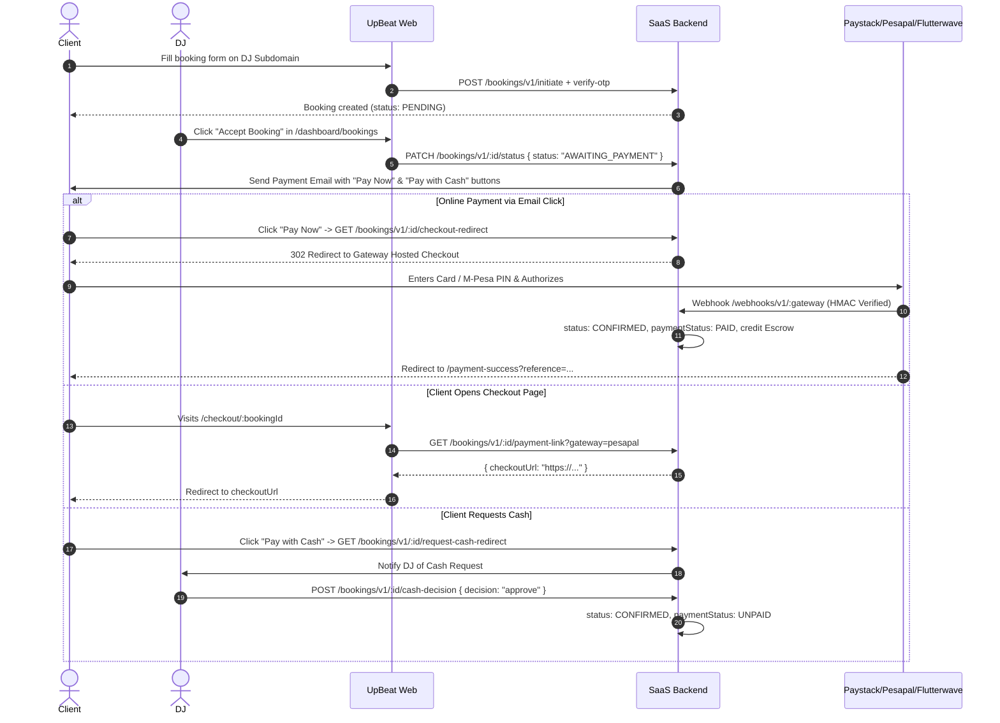

# UpBeat Africa — Frontend Payment & Booking Integration API Documentation

Refer to the main guide at `FRONTEND_PAYMENT_INTEGRATION_API_DOCS.md` in the root workspace, or read below for the complete reference of all frontend payment touchpoints:
1. **DJ Subscription Plans & Billing Page** (`/dashboard/billing`)
2. **Customer Booking Payment Flow & Email Links** (`/checkout/[bookingId]` & Direct Redirects)
3. **DJ Booking Management & Cash Workflows** (`/dashboard/bookings`)
4. **DJ Wallet & Payout Settings** (`/dashboard/wallet`)
5. **Supported Gateway & Country Matrix**

---

## 1. Authentication & Base URLs

- **API Base URL (Dev)**: `http://localhost:3030`
- **API Base URL (Prod)**: `https://api.upbeat.africa`
- **Frontend URL**: `http://localhost:3000` / `https://upbeat.africa`
- **Headers Required for Protected Routes**:
  ```http
  Authorization: Bearer <JWT_ACCESS_TOKEN>
  Content-Type: application/json
  ```
- **Public Routes**: Customer booking endpoints and payment link generation do **not** require DJ authorization headers.

---

## 2. DJ Subscription Plans & Billing Page (`/dashboard/billing`)

This flow handles DJs upgrading, downgrading, and renewing their SaaS membership.

### 2.1 Fetch Available Plans
Displays the pricing cards (Starter, Pro, Elite) with monthly/yearly pricing.

- **Endpoint**: `GET /subscriptions/v1/plans`
- **Auth**: Public / Optional Bearer
- **Response**:
  ```json
  {
    "success": true,
    "message": "Plans retrieved successfully",
    "data": [
      {
        "id": 1,
        "name": "Starter",
        "priceMonthly": 500,
        "priceAnnually": 5000,
        "discountPercentage": 16,
        "features": {
          "CUSTOM_SUBDOMAIN": true,
          "BASIC_PROFILE": true,
          "MANUAL_BOOKINGS": true,
          "MAX_EVENTS": 5
        }
      },
      {
        "id": 2,
        "name": "Pro",
        "priceMonthly": 750,
        "priceAnnually": 7500,
        "discountPercentage": 16,
        "features": {
          "CUSTOM_SUBDOMAIN": true,
          "ONLINE_PAYMENTS": true,
          "AUTOMATED_INVOICING": true,
          "MAX_EVENTS": 50
        }
      }
    ]
  }
  ```

### 2.2 Get Available Gateways For User Country
Dynamically displays payment methods (Paystack, Pesapal, Flutterwave) based on the DJ's country.

- **Endpoint**: `GET /subscriptions/v1/gateways?country=KE`
- **Auth**: Public / Optional Bearer
- **Response**:
  ```json
  {
    "success": true,
    "message": "Available gateways retrieved successfully",
    "data": [
      {
        "id": "pesapal",
        "name": "Pesapal",
        "title": "Pesapal (Mobile Money & Cards)",
        "description": "Instant payment via M-Pesa, Airtel Money & Cards",
        "currencies": ["KES", "TZS", "UGX", "USD"],
        "isRecommended": true,
        "badge": "Recommended for East Africa",
        "paymentMethods": ["M-Pesa", "Airtel Money", "Visa/Mastercard"]
      },
      {
        "id": "paystack",
        "name": "Paystack",
        "title": "Paystack Checkout",
        "description": "Credit/Debit Cards & Direct Bank Transfer",
        "currencies": ["NGN", "GHS", "ZAR", "KES", "USD"],
        "isRecommended": false,
        "badge": "Cards & Bank Transfer",
        "paymentMethods": ["Visa", "Mastercard", "Verve", "Bank Transfer"]
      }
    ]
  }
  ```

### 2.3 Initiate Subscription Checkout
Triggered when the DJ clicks "Subscribe Now" and selects a payment gateway in the modal.

- **Endpoint**: `POST /subscriptions/v1/subscribe`
- **Auth**: Bearer Token (Role: `DJ`)
- **Request Body**:
  ```json
  {
    "planId": 2,
    "billingCycle": "monthly",
    "gateway": "paystack",
    "successUrl": "http://localhost:3000/dashboard/billing?success=true",
    "cancelUrl": "http://localhost:3000/dashboard/billing?canceled=true"
  }
  ```
  *(Note: `gateway` can be `"paystack"`, `"pesapal"`, or `"flutterwave"`. If omitted, the backend picks the optimal gateway based on the DJ's country.)*
- **Response**:
  ```json
  {
    "success": true,
    "message": "Subscription checkout initialized",
    "data": {
      "url": "https://checkout.paystack.com/0123456789abcdef"
    }
  }
  ```
- **Frontend Action**: 
  Redirect the browser: `window.location.href = response.data.url`.

### 2.4 Get DJ's Current Subscription & Invoices
- **Endpoint**: `GET /subscriptions/v1/my-subscription`
- **Auth**: Bearer Token (Role: `DJ`)
- **Response**:
  ```json
  {
    "success": true,
    "data": {
      "id": "sub_uuid",
      "status": "active",
      "periodEnd": "2026-10-08T00:00:00.000Z",
      "plan": {
        "id": 2,
        "name": "Pro",
        "priceMonthly": 750
      }
    }
  }
  ```

### 2.5 Cancel Subscription
- **Endpoint**: `POST /subscriptions/v1/cancel`
- **Auth**: Bearer Token (Role: `DJ`)
- **Response**:
  ```json
  {
    "success": true,
    "message": "Subscription canceled"
  }
  ```

---

## 3. Customer Booking Payment Flow & Email Links

This flow handles clients booking a DJ, receiving payment requests via email, and paying online or opting for cash.



### 3.1 Email Links Triggered on Acceptance
When the DJ accepts a booking, the client receives an email containing two actionable buttons:
1. **Pay Online Button**:
   - Link: `https://api.upbeat.africa/bookings/v1/:id/checkout-redirect`
   - Behavior: Directly creates a payment session with the DJ's primary country gateway and issues an HTTP 302 redirect straight to the Paystack / Pesapal / Flutterwave checkout page. No manual frontend clicks needed.
2. **Pay With Cash Button**:
   - Link: `https://api.upbeat.africa/bookings/v1/:id/request-cash-redirect`
   - Behavior: Records the client's cash request, sends a notification email to the DJ, and displays a clean confirmation screen to the client.

### 3.2 Frontend Checkout Page (`/checkout/[bookingId]`)
If the client opens the custom checkout page or wishes to pick their payment method:

#### Step 1: Fetch Booking Details
- **Endpoint**: `GET /bookings/v1/:id` *(or public view route)*
- **Response**: Returns booking amount, currency, event details, client info.

#### Step 2: Generate Checkout URL for Selected Gateway
- **Endpoint**: `GET /bookings/v1/:id/payment-link?gateway=pesapal`
- **Query Parameters**:
  - `gateway` (optional): `"paystack"`, `"pesapal"`, or `"flutterwave"`.
- **Response**:
  ```json
  {
    "success": true,
    "message": "Payment link generated successfully",
    "data": {
      "checkoutUrl": "https://pay.pesapal.com/iframe/PesapalIframe3/Index?OrderTrackingId=...",
      "reference": "bkg_abc123_1725792000000",
      "gateway": "PESAPAL",
      "amount": 45000,
      "currency": "KES"
    }
  }
  ```
- **Frontend Action**: 
  Redirect user: `window.location.href = response.data.checkoutUrl`.

#### Step 3: Request Cash Payment via UI
- **Endpoint**: `PATCH /bookings/v1/:id/request-cash`
- **Auth**: Public
- **Response**:
  ```json
  {
    "success": true,
    "message": "Cash payment requested. The DJ has been notified."
  }
  ```

### 3.3 Post-Payment Redirects
After paying on Paystack, Pesapal, or Flutterwave, the gateway redirects the user to:
- **Success URL**: `/payment-success?reference=<GATEWAY_REFERENCE>`
  - Page displays celebration graphic, booking summary, and button back to DJ profile or dashboard.
- **Cancel URL**: `/payment-cancel?reference=<GATEWAY_REFERENCE>`
  - Page displays friendly cancellation message with a "Try Again" button.

---

## 4. DJ Booking Management (`/dashboard/bookings`)

DJs manage incoming gigs, accept payments, and record event execution.

### 4.1 Strict Booking State Machine
Allowed statuses in the database:
- `PENDING`: Newly submitted by customer.
- `AWAITING_PAYMENT`: DJ accepted; awaiting client online payment or cash approval.
- `CONFIRMED`: Paid via gateway OR cash approved by DJ.
- `IN_PROGRESS`: Event day has arrived and gig is active.
- `COMPLETED`: Event ended successfully. **Escrow balance released to DJ wallet!**
- `CANCELLED`: Cancelled by DJ or client.
- `REJECTED`: DJ declined the gig.
- `NO_SHOW`: Client or DJ did not attend.

> **Note on `UPCOMING`:** `UPCOMING` is **not** a database enum. In the frontend UI, derive upcoming bookings as:
> `status === "CONFIRMED" && new Date(eventDate) > new Date()`

### 4.2 Updating Booking Status
- **Endpoint**: `PATCH /bookings/v1/:id/status`
- **Auth**: Bearer Token (Role: `DJ`)
- **Request Body**:
  ```json
  {
    "status": "AWAITING_PAYMENT",
    "cashBooking": false
  }
  ```
- **Response**:
  ```json
  {
    "success": true,
    "message": "Booking status updated to AWAITING_PAYMENT",
    "data": {
      "booking": {
        "id": "uuid",
        "status": "AWAITING_PAYMENT",
        "paymentStatus": "UNPAID"
      },
      "checkoutUrl": "https://checkout.paystack.com/..."
    }
  }
  ```

### 4.3 Resend Payment Reminder Email
If client has not paid after 24 hours:
- **Endpoint**: `POST /bookings/v1/:id/remind-payment`
- **Auth**: Bearer Token (Role: `DJ`)
- **Response**:
  ```json
  {
    "success": true,
    "message": "Payment reminder email sent to client"
  }
  ```

### 4.4 DJ Decision on Cash Requests
When client requested cash payment:
- **Endpoint**: `POST /bookings/v1/:id/cash-decision`
- **Auth**: Bearer Token (Role: `DJ`)
- **Request Body**:
  ```json
  {
    "decision": "approve"
  }
  ```
  *(Options: `"approve"` or `"reject"`)*
- **Response**:
  ```json
  {
    "success": true,
    "message": "Cash payment request approved. Booking is now confirmed."
  }
  ```

### 4.5 DJ Mark Cash as Paid (Venue Fulfillment)
When the DJ receives cash in hand at the event:
- **Endpoint**: `POST /bookings/v1/:id/mark-cash-paid`
- **Auth**: Bearer Token (Role: `DJ`)
- **Response**:
  ```json
  {
    "success": true,
    "message": "Booking marked as cash paid successfully."
  }
  ```

---

## 5. DJ Wallet & Payout System (`/dashboard/wallet`)

The DJ wallet manages earnings, escrow from upcoming events, and withdrawals to African bank accounts or mobile money wallets.

### 5.1 Fetch DJ Wallet & Payout Overview
- **Endpoint**: `GET /wallet/v1/me?tenantId=<TENANT_ID>`
- **Auth**: Bearer Token (Role: `DJ`)
- **Response**:
  ```json
  {
    "success": true,
    "message": "Wallet retrieved successfully",
    "data": {
      "wallet": {
        "id": "wallet_uuid",
        "tenantId": "tenant_uuid",
        "pendingBalance": 45000,
        "availableBalance": 120000,
        "totalEarnings": 165000,
        "totalWithdrawn": 50000,
        "currency": "KES"
      },
      "connectedAccount": {
        "gateway": "PAYSTACK",
        "bankName": "Equity Bank",
        "accountName": "DJ Spin Master Ltd",
        "recipientCode": "RCP_abcdef12345"
      },
      "payoutRequests": [
        {
          "id": "payout_uuid",
          "amount": 25000,
          "fee": 0,
          "currency": "KES",
          "gateway": "PAYSTACK",
          "status": "COMPLETED",
          "createdAt": "2026-09-01T10:00:00.000Z"
        }
      ],
      "ledgers": [
        {
          "id": "ledger_uuid",
          "amount": 45000,
          "currency": "KES",
          "type": "ESCROW_RELEASED",
          "previousBalance": 75000,
          "newBalance": 120000,
          "description": "Released funds for completed gig #bkg_123",
          "createdAt": "2026-09-07T18:30:00.000Z"
        }
      ]
    }
  }
  ```

### 5.2 Get Available Payout Banks / Providers
- **Endpoint**: `GET /paystack-connect/v1/banks?country=kenya`
- **Auth**: Bearer Token
- **Response**:
  ```json
  {
    "success": true,
    "data": [
      { "id": 1, "name": "Equity Bank", "code": "068" },
      { "id": 2, "name": "KCB Bank", "code": "001" },
      { "id": 3, "name": "M-Pesa Paybill / Till", "code": "MPESA" }
    ]
  }
  ```

### 5.3 Validate Bank or Mobile Money Account
Validates the account with Paystack before saving so the DJ sees their registered business/account name.
- **Endpoint**: `POST /paystack-connect/v1/validate`
- **Auth**: Bearer Token
- **Request Body**:
  ```json
  {
    "accountNumber": "0123456789",
    "bankCode": "068",
    "gateway": "paystack"
  }
  ```
- **Response**:
  ```json
  {
    "success": true,
    "message": "Account validated",
    "data": {
      "valid": true,
      "accountName": "DJ SPIN MASTER"
    }
  }
  ```

### 5.4 Connect / Save Payout Account
- **Endpoint**: `POST /paystack-connect/v1/onboard`
- **Auth**: Bearer Token
- **Request Body**:
  ```json
  {
    "bankCode": "068",
    "accountNumber": "0123456789",
    "accountName": "DJ SPIN MASTER"
  }
  ```
- **Response**:
  ```json
  {
    "success": true,
    "message": "Payout account connected successfully"
  }
  ```

### 5.5 Request Withdrawal
Withdraws funds from `availableBalance` to the DJ's saved bank account or mobile money.
- **Endpoint**: `POST /wallet/v1/withdraw`
- **Auth**: Bearer Token
- **Request Body**:
  ```json
  {
    "amount": 25000,
    "note": "Weekly gig withdrawal"
  }
  ```
- **Response**:
  ```json
  {
    "success": true,
    "message": "Payout request submitted successfully",
    "data": {
      "id": "payout_uuid",
      "amount": 25000,
      "status": "PROCESSING",
      "gateway": "PAYSTACK"
    }
  }
  ```

### 5.6 Disconnect Payout Account
- **Endpoint**: `DELETE /paystack-connect/v1/disconnect`
- **Auth**: Bearer Token
- **Response**:
  ```json
  {
    "success": true,
    "message": "Payout account removed successfully"
  }
  ```

---

## 6. Country & Payment Gateway Matrix

The backend automatically resolves the primary gateway according to the country:

| Country | Code | Currency | Default Collection Gateway | Mobile Money Support | Payout Methods |
| :--- | :--- | :--- | :--- | :--- | :--- |
| **Nigeria** | `NG` | `NGN` | **Paystack** | Bank Transfer, USSD | Nigerian Bank Accounts |
| **Ghana** | `GH` | `GHS` | **Paystack** / **Flutterwave** | MTN, Vodafone, AirtelTigo | Mobile Money & Banks |
| **Kenya** | `KE` | `KES` | **Paystack** / **Pesapal** | M-Pesa, Airtel Money | M-Pesa & Kenyan Banks |
| **South Africa** | `ZA` | `ZAR` | **Paystack** | EFT, Cards | South African Banks |
| **Tanzania** | `TZ` | `TZS` | **Pesapal** / **Flutterwave** | Vodacom M-Pesa, Tigo Pesa, Airtel Money | Mobile Money & Banks |
| **Uganda** | `UG` | `UGX` | **Pesapal** / **Flutterwave** | MTN MoMo, Airtel Money | Mobile Money & Banks |
| **Rwanda** | `RW` | `RWF` | **Pesapal** / **Flutterwave** | MTN MoMo, Airtel Money | Mobile Money & Banks |
| **International** | `US/EU` | `USD/EUR` | **Flutterwave** / **Paystack** | International Visa & Mastercard | Wire / Gateway Transfer |
